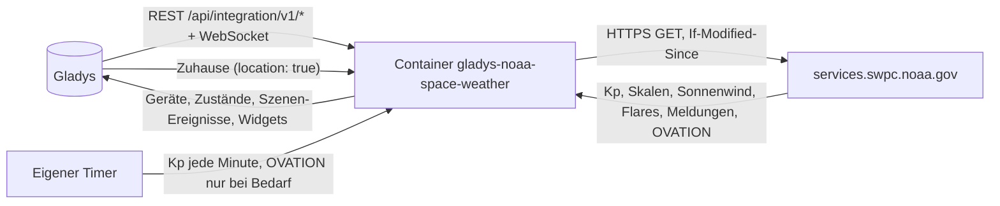
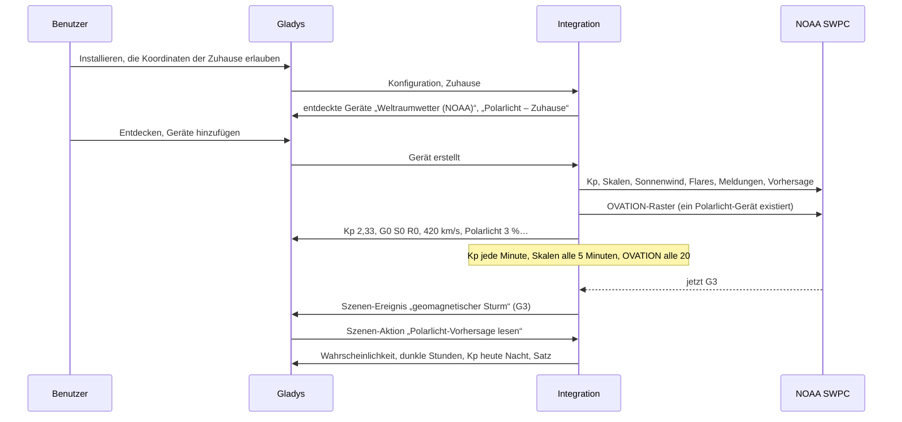
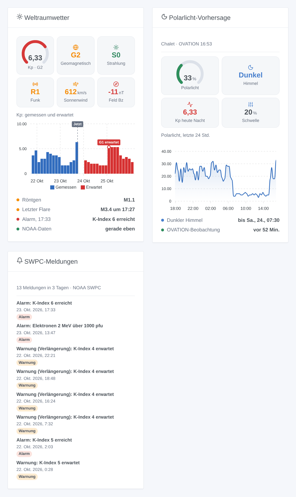

# Gladys NOAA Space Weather

[English](README.md) · [Français](README.fr.md) · **Deutsch** · [Español](README.es.md)

[](LICENSE)
[](https://github.com/William-De71/gladys-noaa-space-weather/releases)
[](https://github.com/William-De71/gladys-noaa-space-weather/actions/workflows/release.yml)
[](https://gladysassistant.com)


Externe Integration für [Gladys Assistant](https://gladysassistant.com) für das Weltraumwetter des [Space Weather Prediction Center der NOAA](https://www.swpc.noaa.gov/) (SWPC): Kp-Index, NOAA-Skalen für geomagnetische Stürme, Strahlungsstürme und Funkausfälle, Sonnenwind, Sonneneruptionen, SWPC-Meldungen und die OVATION-Polarlichtvorhersage an jedem deiner Zuhause. Öffentliche Daten, ohne Konto und ohne Schlüssel: Deine Szenen erfahren, wenn ein Sturm beginnt, wenn ein X-Flare den Funk stört oder wenn heute Nacht bei dir Polarlicht sichtbar sein könnte.

Benutzerdokumentation: [English](docs/en.md) · [Français](docs/fr.md) · [Deutsch](docs/de.md) · [Español](docs/es.md).

Daten: NOAA SWPC, gemeinfrei (Quelle: NOAA Space Weather Prediction Center). **Nicht mit der NOAA verbunden.** Entwickelt und getestet mit den echten Dateien des SWPC vom 23. Oktober 2026, einem ruhigen Tag: Die Sturmfälle werden mit veränderten Kopien getestet.

## Funktionen

- **Gerät Weltraumwetter**: geschätzter Kp (jede Minute), offizieller 3-Stunden-Kp, aktuelle NOAA-Skalen G / S / R, Sonnenwindgeschwindigkeit, Magnetfeld Bz und Bt, Radiofluss 10,7 cm, Klasse der Röntgenstrahlung.
- **Ein Polarlicht-Gerät pro Zuhause mit Standort**: OVATION-Wahrscheinlichkeit für Polarlicht im Zenit, dunkler Himmel (Sonne 6° unter dem Horizont), höchster erwarteter Kp in den nächsten dunklen Stunden.
- **9 Szenen-Auslöser** (geomagnetischer Sturm und sein Ende, Strahlungssturm, Funkausfall, M- oder X-Flare, Polarlicht möglich und sein Ende, neue SWPC-Meldung, vorhergesagter Sturm), **3 Szenen-Aktionen** (Weltraumwetter, Polarlicht an einem Zuhause, 3-Tage-Vorhersage, jede mit einem fertigen Satz) und **3 Dashboard-Widgets** (Überblick, Polarlicht, SWPC-Meldungen).
- **Sparsam mit einem kostenlosen Dienst**: jedes Produkt in seinem Takt, bedingte Anfragen (ein 304 für eine unveränderte Datei), das 1-MB-Polarlicht-Raster nur, wenn ein Polarlicht-Gerät oder -Widget es braucht, doppelte Wartezeit nach jedem Fehler, ein kleiner Cache in `/data`.
- Beide Formate der SWPC-Dateien: die alten Tabellen (ein Array von Arrays mit Kopfzeile) und die neuen Arrays von Objekten.
- Vier Sprachen überall: Englisch, Französisch, Deutsch, Spanisch.

## Funktionsweise




Von der Installation zur Szene:



### Transport

`transports: ["cloud"]`: Alles kommt von `services.swpc.noaa.gov`. **Nichts von dir verlässt dein Netzwerk** außer Anfragen nach öffentlichen Dateien mit einem User-Agent, der die Integration nennt: kein Konto, kein Schlüssel, nie die Koordinaten deiner Zuhause (das Polarlicht-Raster wird vollständig geladen und im Container gelesen). `/data` behält die letzten Werte jedes Produkts, die Wahrscheinlichkeiten der letzten 24 Stunden pro Zuhause und das, was die Auslöser schon wissen.

## Geräte und Funktionen

| Gerät                 | Funktion                                                        | Kategorie / Typ       | Bereich          |
| --------------------- | --------------------------------------------------------------- | --------------------- | ---------------- |
| Weltraumwetter (NOAA) | Geschätzter Kp, Kp-Index (3 Std.)                               | `unknown` / `unknown` | 0–9              |
|                       | Geomagnetischer Sturm (G), Strahlungssturm (S), Funkausfall (R) | `risk` / `integer`    | 0–5              |
|                       | Sonnenwind (km/s)                                               | `unknown` / `unknown` | 0–3.000          |
|                       | Magnetfeld Bz (nT), Bt (nT)                                     | `unknown` / `unknown` | −150–150, 0–200  |
|                       | Radiofluss 10,7 cm (sfu)                                        | `unknown` / `unknown` | 0–1.000          |
|                       | Röntgenklasse                                                   | `text` / `text`       | „B5.4“           |
| Polarlicht – Zuhause  | Polarlicht-Wahrscheinlichkeit (%), Kp heute Nacht               | `unknown` / `unknown` | 0–100, 0–9       |
|                       | Dunkler Himmel                                                  | `unknown` / `unknown` | 1 dunkel, 0 hell |

Gladys hat keine Einheit für km/s, nT, sfu oder den Kp, und seine Einheitentabelle gibt den Kategorien `unknown`, `risk` und `text` keine: Die Funktionen haben keine Einheit und nennen sie in ihrem Namen (eine Geschwindigkeit in km/h zeigte 1.512.000 für 420 km/s). Nur Änderungen werden veröffentlicht, und alles erneut, wenn ein Gerät erstellt wird.

## Szenen-Auslöser, Aktionen und Widgets



| Art      | Schlüssel                           | Zweck                                                                                                           |
| -------- | ----------------------------------- | --------------------------------------------------------------------------------------------------------------- |
| Auslöser | `geomagnetic_storm`                 | G erreicht in einer Episode eine neue Stufe; Filter nach Stufen (G3, G4, G5 für „G3 oder mehr“)                 |
| Auslöser | `geomagnetic_storm_ended`           | seit 3 Stunden wieder G0                                                                                        |
| Auslöser | `radiation_storm`, `radio_blackout` | S oder R erreicht eine neue Stufe                                                                               |
| Auslöser | `solar_flare`                       | ein Flare erreicht M oder X (Filter X: nur starke), mit Klasse, Beginn, Höhepunkt, R-Stufe                      |
| Auslöser | `aurora_possible`, `aurora_ended`   | an einem Polarlicht-Gerät: Wahrscheinlichkeit erreicht bei dunklem Himmel die Schwelle; Dämmerung oder Rückgang |
| Auslöser | `swpc_alert`                        | jede neue SWPC-Meldung, gefiltert nach Art und Thema; Kurztitel übersetzt, Text auf Englisch                    |
| Auslöser | `storm_forecast`                    | Kp von 5 oder mehr in 3 Tagen erwartet, einmal pro Episode                                                      |
| Aktion   | `get_space_weather`                 | Kp, G/S/R, Sonnenwind, Bz, Bt, Fluss, Röntgen, letzter Flare, Satz                                              |
| Aktion   | `get_aurora`                        | ein Zuhause: Wahrscheinlichkeit, dunkle Stunden, Kp heute Nacht, Schwelle, Satz                                 |
| Aktion   | `get_forecast`                      | höchster Kp pro UTC-Tag, erwartetes G, Wahrscheinlichkeiten für R1–R2, R3+, S1+, Satz                           |
| Widget   | `overview`                          | Kp-Anzeige, G/S/R, Sonnenwind, Bz, Kp gemessen und erwartet, Röntgen, letzter Flare, letzte Meldung             |
| Widget   | `aurora`                            | Wahrscheinlichkeit, Himmel, Kp heute Nacht, Schwelle, letzte 24 Stunden, dunkle Stunden                         |
| Widget   | `alerts`                            | die letzten SWPC-Meldungen (Arten und Zeitraum in den Einstellungen)                                            |

Jeder Auslöser liefert `{{triggerEvent.data.sentence}}`, einen Satz in der Sprache der Konfiguration. Ereignisse kommen einmal pro Übergang, nie beim Start und nie infolge einer Szenen-Aktion. Beispiele:

- Wenn **NOAA: geomagnetischer Sturm** mit G3, G4, G5 → `{{triggerEvent.data.sentence}}` als Benachrichtigung senden.
- Wenn **NOAA: Polarlicht möglich** am Polarlicht-Gerät der Hütte → „Polarlicht heute Nacht möglich, {{triggerEvent.data.probability}} %: schau nach Norden“ senden.
- Wenn **NOAA: Sonneneruption** der Klasse X → den Funkamateur warnen: „X-Flare {{triggerEvent.data.class}}: KW-Funk und GPS können gestört sein“.

## Voraussetzungen

- Gladys Assistant **5.3.0** oder neuer (Widgets und Szenen der Integrationen, Katalog-Suchbegriffe von Gladys 5.3): Ältere Instanzen können die Integration nicht installieren.
- Internet: Die Integration spricht nur mit `services.swpc.noaa.gov`.
- Für Polarlicht: ein Zuhause mit Standort in Gladys (die Integration deklariert `location: true`, um ihn zu lesen).

### Breite und Polarlicht

Unterhalb von etwa 55° magnetischer Breite (der Großteil Deutschlands, Frankreich, Spanien) ist Polarlicht selten: Es braucht einen starken Sturm (G3 oder mehr), einige Male pro Sonnenzyklus. In Skandinavien, Island, Kanada oder Alaska ist es häufig. Die OVATION-Wahrscheinlichkeit gilt für Polarlicht **im Zenit**; Polarlicht weiter nördlich kann trotzdem tief am Nordhorizont sichtbar sein, was dieser Wert nicht sagt.

## Installation

- **Aus dem Store**: Integrationen → NOAA Space Weather → Installieren.
- **Über die Repository-URL**: Integrationen → externe Integration → `https://github.com/William-De71/gladys-noaa-space-weather`.
- **Entwicklermodus**: `npm start` mit den von Gladys gelieferten Variablen starten (siehe Entwicklung).

## Konfiguration

| Feld oder Schaltfläche       | Standard    | Bedeutung                                                                        |
| ---------------------------- | ----------- | -------------------------------------------------------------------------------- |
| Sprache der Texte            | automatisch | Gerätenamen, Sätze und Fehler der Szenen                                         |
| Polarlicht-Schwelle          | 10 %        | 5 bis 50 %: ab hier ist Polarlicht an einem Zuhause bei dunklem Himmel „möglich“ |
| Verbindung testen / Diagnose | —           | Liest Skalen und Kp, listet die Zuhause mit Standort; der Zustand in den Logs    |

## Verwendung

1. Installiere die Integration und erlaube die Koordinaten der Zuhause.
2. Drücke bei Bedarf **Verbindung testen**.
3. **Entdecken**, dann das Gerät Weltraumwetter und die Polarlicht-Geräte der gewünschten Zuhause hinzufügen.
4. Füge die Widgets einem Dashboard hinzu und baue Szenen mit den Funktionen, Auslösern und Aktionen.

## Entwicklung

```bash
npm install
npm test                       # node --test, ein falsches SWPC auf 127.0.0.1 (echte Dateien), nie das Netzwerk
npm run lint                   # ESLint
npm run format:check           # Prettier
npx github:GladysAssistant/integration-store . --skip-image-check
scripts/build-cover.sh         # cover.jpg aus docs/assets/cover.svg
docs/illustrations/render.sh   # docs/assets/widgets.<lang>.png
```

Lokal liest das SDK `GLADYS_HOST_API_URL`, `GLADYS_INTEGRATION_TOKEN` und `GLADYS_INTEGRATION_SELECTOR` (von Gladys im Entwicklermodus geliefert), und die Integration liest `TZ`. `DEBUG=gladys-integration-sdk` zeigt die SDK-Logs.

Die Tests decken den HTTP-Client (User-Agent, 304, Fehler, abgeschnittenes JSON), die Leser (beide Formate, die ersten Minuten des geschätzten Kp), die SWPC-Meldungen und ihre Titel, das OVATION-Raster (Längen 0–359 und die Naht, die neun Felder, die Pole), die Sonne und den dunklen Himmel, jeden Detektor (Übergänge, keine Wiederholung, nichts beim Start), die Ausgaben und Nutzdaten, die Geräte, die Widgets (`validateWidgetContent`), das Manifest, die vier Sprachen, das Release-Skript und die ganze Integration gegen das falsche Gladys des SDK und einen falschen SWPC-Server ab. `test/structure.test.js` friert jeden gespeicherten Schlüssel ein.

## Release-Prozess


Jeder Merge auf `main` startet die CI und berechnet dann die Version aus den [Conventional Commits](https://www.conventionalcommits.org/) seit dem letzten Tag: `feat` → Minor, `fix` / `perf` → Patch, `!` oder `BREAKING CHANGE` → Major (ein Minor unter 1.0.0); `docs`, `chore`, `ci`, `test`, `style`, `refactor`, `build` allein veröffentlichen nichts. Der Changelog-Abschnitt wird erzeugt, das Tag gepusht, das Multi-Architektur-Image gebaut, dann erhält `main` den Release-Commit, das GitHub Release wird erstellt und ein letzter Job prüft das öffentliche Image, den Store-Validator und das Topic.

- Der Titel des Pull Requests wird zum Squash-Commit und dann zur Changelog-Zeile: auf Englisch, für den Benutzer (`pr-title.yml` prüft ihn). `CHANGELOG.md` nie von Hand bearbeiten.
- 1.0.0 ist eine Entscheidung: Actions → Release → Run workflow mit `release-as: 1.0.0`. `dry-run` zeigt Version und Notizen, ohne zu veröffentlichen.
- **Geschützter Branch**: Das Release pusht seinen Commit mit `GITHUB_TOKEN` auf `main`. Das Ruleset `protect-main` (kein Löschen, kein Force-Push) lässt ihn durch; eine strengere Regel (Pull Request Pflicht, Status-Checks) bräuchte GitHub Actions in der Bypass-Liste oder eine GitHub App.
- Nach dem ersten Release das `ghcr.io`-Paket öffentlich machen (Package settings → Change visibility), sonst kann Gladys es nicht laden.

## Fehlerbehebung

Siehe [docs/de.md](docs/de.md#fehlerbehebung). Melde Probleme mit den Versionen von Gladys und der Integration, der Meldung von **Verbindung testen** und dem Ergebnis von **Diagnose** (in den Logs der Integration).

## Mitwirken

Issues und Pull Requests sind willkommen. Führe vor einem Pull Request `npm run format:check && npm run lint && npm test` aus und lass alle External IDs und gespeicherten Schlüssel unverändert (siehe [CLAUDE.md](CLAUDE.md)).

## Sicherheit

Siehe [SECURITY.md](SECURITY.md): Schwachstellen bitte vertraulich melden. Die Integration hat kein Geheimnis; die Koordinaten der Zuhause bleiben im Container und erscheinen nie in den Logs.

## Kommende Screenshots

Die Bilder oben sind Illustrationen, keine Screenshots. Echte Screenshots kommen nach `docs/assets/screenshots/` (PNG, 1280 × 800): `configuration.png`, `discovery.png` (die Geräte Weltraumwetter und Polarlicht), `device.png` (das Gerät Weltraumwetter mit seinen Funktionen), `scene-aurora.png` (eine Szene auf „Polarlicht möglich“).

## Lizenz

[Apache License 2.0](LICENSE) — siehe auch [NOTICE](NOTICE). Daten: NOAA Space Weather Prediction Center, gemeinfrei; diese Integration ist nicht mit der NOAA verbunden. Danke an die Dokumentation und das SDK von Gladys und an das SWPC für seine offenen Daten.
