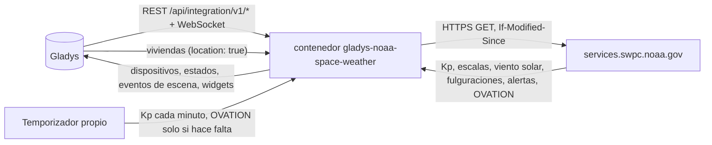
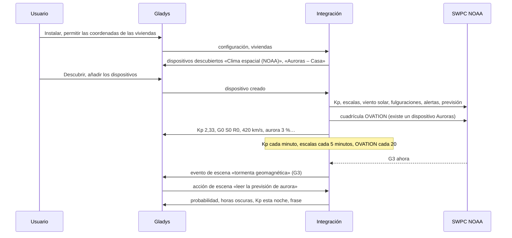
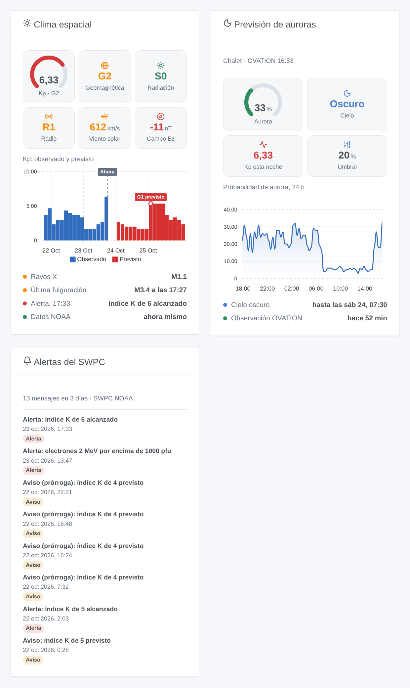

# Gladys NOAA Space Weather

[English](README.md) · [Français](README.fr.md) · [Deutsch](README.de.md) · **Español**

[](LICENSE)
[](https://github.com/William-De71/gladys-noaa-space-weather/releases)
[](https://github.com/William-De71/gladys-noaa-space-weather/actions/workflows/release.yml)
[](https://gladysassistant.com)


Integración externa de [Gladys Assistant](https://gladysassistant.com) para el clima espacial del [Space Weather Prediction Center de la NOAA](https://www.swpc.noaa.gov/) (SWPC): índice Kp, escalas NOAA de tormentas geomagnéticas, tormentas de radiación y apagones de radio, viento solar, fulguraciones solares, alertas del SWPC y la previsión de auroras OVATION en cada una de sus viviendas. Datos públicos, sin cuenta ni clave: sus escenas saben cuándo empieza una tormenta, cuándo una fulguración X perturba la radio o cuándo podría verse una aurora en casa esta noche.

Documentación de usuario: [English](docs/en.md) · [Français](docs/fr.md) · [Deutsch](docs/de.md) · [Español](docs/es.md).

Datos: NOAA SWPC, dominio público (crédito: NOAA Space Weather Prediction Center). **No afiliada a la NOAA.** Escrita y probada con los archivos reales del SWPC del 23 de octubre de 2026, un día tranquilo: los casos de tormenta se prueban con copias modificadas.

## Funciones

- **Dispositivo Clima espacial**: Kp estimado (cada minuto), Kp oficial de 3 horas, escalas NOAA G / S / R actuales, velocidad del viento solar, campo magnético Bz y Bt, flujo de radio de 10,7 cm, clase del flujo de rayos X.
- **Un dispositivo Auroras por vivienda con ubicación**: probabilidad OVATION de una aurora en el cenit, cielo oscuro (el sol a 6° bajo el horizonte), Kp máximo previsto durante las próximas horas de cielo oscuro.
- **9 disparadores de escena** (tormenta geomagnética y su fin, tormenta de radiación, apagón de radio, fulguración M o X, aurora posible y su fin, nuevo mensaje del SWPC, tormenta prevista), **3 acciones de escena** (clima espacial, aurora en una vivienda, previsión a 3 días, cada una con una frase lista para enviar) y **3 widgets** (resumen, auroras, alertas del SWPC).
- **Sobria con un servicio gratuito**: cada producto a su ritmo, peticiones condicionales (un 304 para un archivo sin cambios), la cuadrícula de auroras de 1 MB solo si un dispositivo Auroras o un widget de aurora la necesita, una espera duplicada tras cada fallo, una pequeña caché en `/data`.
- Los dos formatos de los archivos del SWPC: las antiguas tablas (un array de arrays con fila de cabecera) y los nuevos arrays de objetos.
- Cuatro idiomas en todo: inglés, francés, alemán, español.

## Cómo funciona




De la instalación a una escena:



### Transporte

`transports: ["cloud"]`: todo viene de `services.swpc.noaa.gov`. **Nada suyo sale de su red** salvo peticiones de archivos públicos con un User-Agent que nombra la integración: ni cuenta, ni clave, nunca las coordenadas de sus viviendas (la cuadrícula de auroras se descarga entera y se lee en el contenedor). `/data` guarda los últimos valores de cada producto, las probabilidades de las últimas 24 horas por vivienda y lo que los disparadores ya saben.

## Dispositivos y funciones

| Dispositivo           | Función                                                                   | Categoría / tipo      | Rango             |
| --------------------- | ------------------------------------------------------------------------- | --------------------- | ----------------- |
| Clima espacial (NOAA) | Kp estimado, índice Kp (3 h)                                              | `unknown` / `unknown` | 0–9               |
|                       | Tormenta geomagnética (G), tormenta de radiación (S), apagón de radio (R) | `risk` / `integer`    | 0–5               |
|                       | Viento solar (km/s)                                                       | `unknown` / `unknown` | 0–3000            |
|                       | Campo magnético Bz (nT), Bt (nT)                                          | `unknown` / `unknown` | −150–150, 0–200   |
|                       | Flujo de radio 10,7 cm (sfu)                                              | `unknown` / `unknown` | 0–1000            |
|                       | Clase de rayos X                                                          | `text` / `text`       | «B5.4»            |
| Auroras – vivienda    | Probabilidad de aurora (%), Kp previsto esta noche                        | `unknown` / `unknown` | 0–100, 0–9        |
|                       | Cielo oscuro                                                              | `unknown` / `unknown` | 1 oscuro, 0 claro |

Gladys no tiene unidad para km/s, nT, sfu ni para el Kp, y su tabla de unidades no da ninguna a las categorías `unknown`, `risk` y `text`: las funciones no tienen unidad y la indican en su nombre (una velocidad en km/h mostraría 1 512 000 para 420 km/s). Solo se publican los cambios, y todo de nuevo al crear un dispositivo.

## Disparadores, acciones y widgets



| Tipo       | Clave                               | Uso                                                                                                         |
| ---------- | ----------------------------------- | ----------------------------------------------------------------------------------------------------------- |
| Disparador | `geomagnetic_storm`                 | G alcanza un nuevo nivel en un episodio; filtro por niveles (G3, G4, G5 para «G3 o más»)                    |
| Disparador | `geomagnetic_storm_ended`           | de nuevo en G0 desde hace 3 horas                                                                           |
| Disparador | `radiation_storm`, `radio_blackout` | S o R alcanza un nuevo nivel                                                                                |
| Disparador | `solar_flare`                       | una fulguración alcanza M o X (filtro X: solo las fuertes), con clase, inicio, pico, nivel R                |
| Disparador | `aurora_possible`, `aurora_ended`   | en un dispositivo Auroras: la probabilidad alcanza el umbral con cielo oscuro; amanecer o bajada            |
| Disparador | `swpc_alert`                        | cada nuevo mensaje del SWPC, filtrado por tipo y tema; título corto traducido, texto en inglés              |
| Disparador | `storm_forecast`                    | un Kp de 5 o más previsto en 3 días, una vez por episodio                                                   |
| Acción     | `get_space_weather`                 | Kp, G/S/R, viento solar, Bz, Bt, flujo, rayos X, última fulguración, frase                                  |
| Acción     | `get_aurora`                        | una vivienda: probabilidad, horas oscuras, Kp esta noche, umbral, frase                                     |
| Acción     | `get_forecast`                      | Kp máximo por día UTC, G previsto, probabilidades de R1–R2, R3+, S1+, frase                                 |
| Widget     | `overview`                          | indicador Kp, G/S/R, viento solar, Bz, Kp observado y previsto, rayos X, última fulguración, último mensaje |
| Widget     | `aurora`                            | probabilidad, cielo, Kp esta noche, umbral, últimas 24 horas, horas oscuras                                 |
| Widget     | `alerts`                            | los últimos mensajes del SWPC (tipos y periodo en los ajustes)                                              |

Cada disparador ofrece `{{triggerEvent.data.sentence}}`, una frase en el idioma de la configuración. Los eventos salen una vez por transición, nunca al arrancar ni a raíz de una acción de escena. Ejemplos:

- Cuando **NOAA: tormenta geomagnética** con G3, G4, G5 → enviar `{{triggerEvent.data.sentence}}` como notificación.
- Cuando **NOAA: aurora posible** en el dispositivo Auroras de la cabaña → enviar «Aurora posible esta noche, {{triggerEvent.data.probability}} %: mire hacia el norte».
- Cuando **NOAA: fulguración solar** de clase X → avisar al radioaficionado: «Fulguración X {{triggerEvent.data.class}}: radio HF y GPS pueden fallar».

## Requisitos

- Gladys Assistant **5.1.0** o posterior (widgets y escenas de las integraciones): las instancias anteriores no pueden instalar la integración.
- Internet: la integración solo habla con `services.swpc.noaa.gov`.
- Para las auroras: una vivienda con ubicación en Gladys (la integración declara `location: true` para leerla).

### Latitud y auroras

Por debajo de unos 55° de latitud magnética (España, Francia, Italia) una aurora es rara: hace falta una tormenta fuerte (G3 o más), unas pocas veces por ciclo solar. En Escandinavia, Islandia, Canadá o Alaska es frecuente. La probabilidad OVATION es la de una aurora **en el cenit**; una aurora más al norte puede verse de todos modos baja en el horizonte norte, lo que este valor no indica.

## Instalación

- **Desde la tienda**: Integraciones → NOAA Space Weather → Instalar.
- **Desde la URL del repositorio**: Integraciones → integración externa → `https://github.com/William-De71/gladys-noaa-space-weather`.
- **Modo desarrollador**: ejecute `npm start` con las variables que da Gladys (vea Desarrollo).

## Configuración

| Campo o botón                    | Por defecto | Significado                                                                              |
| -------------------------------- | ----------- | ---------------------------------------------------------------------------------------- |
| Idioma de los textos             | automático  | Nombres de los dispositivos, frases y errores de las escenas                             |
| Umbral de aurora                 | 10 %        | 5 a 50 %: desde ahí, una aurora es «posible» en una vivienda con cielo oscuro            |
| Probar la conexión / Diagnóstico | —           | Lee las escalas y el Kp, enumera las viviendas con ubicación; el estado en los registros |

## Uso

1. Instale la integración y permita las coordenadas de las viviendas.
2. Si lo desea, pulse **Probar la conexión**.
3. **Descubrir**, luego añada el dispositivo Clima espacial y los dispositivos Auroras de las viviendas que quiera.
4. Añada los widgets a un panel y cree escenas con las funciones, los disparadores y las acciones.

## Desarrollo

```bash
npm install
npm test                       # node --test, un SWPC falso en 127.0.0.1 (archivos reales), nunca la red
npm run lint                   # ESLint
npm run format:check           # Prettier
npx github:GladysAssistant/integration-store . --skip-image-check
scripts/build-cover.sh         # cover.jpg desde docs/assets/cover.svg
docs/illustrations/render.sh   # docs/assets/widgets.<lang>.png
```

En local, el SDK lee `GLADYS_HOST_API_URL`, `GLADYS_INTEGRATION_TOKEN` y `GLADYS_INTEGRATION_SELECTOR` (que da Gladys en modo desarrollador), y la integración lee `TZ`. `DEBUG=gladys-integration-sdk` muestra los registros del SDK.

Las pruebas cubren el cliente HTTP (User-Agent, 304, errores, JSON truncado), los lectores (ambos formatos, los primeros minutos del Kp estimado), los mensajes del SWPC y sus títulos, la cuadrícula OVATION (longitudes 0–359 y la costura, las nueve celdas, los polos), el sol y el cielo oscuro, cada detector (transiciones, sin repetición, nada al arrancar), las salidas y las cargas, los dispositivos, los widgets (`validateWidgetContent`), el manifiesto, los cuatro idiomas, el script de release y la integración completa frente al Gladys falso del SDK y un servidor SWPC falso. `test/structure.test.js` congela cada clave guardada por el usuario.

## Proceso de release


Cada fusión en `main` ejecuta la CI y calcula la versión a partir de los [Conventional Commits](https://www.conventionalcommits.org/) desde la última etiqueta: `feat` → menor, `fix` / `perf` → parche, `!` o `BREAKING CHANGE` → mayor (una menor por debajo de 1.0.0); `docs`, `chore`, `ci`, `test`, `style`, `refactor`, `build` solos no publican nada. Se genera la sección del changelog, se sube la etiqueta, se construye la imagen multiarquitectura, luego `main` recibe el commit de release, se crea la GitHub Release y un último job comprueba la imagen pública, el validador de la tienda y el topic.

- El título de la pull request se convierte en el commit squash y luego en la línea del changelog: escríbalo en inglés, para el usuario (`pr-title.yml` lo comprueba). Nunca edite `CHANGELOG.md` a mano.
- La 1.0.0 es una decisión: Actions → Release → Run workflow con `release-as: 1.0.0`. `dry-run` muestra la versión y las notas sin publicar nada.
- **Rama protegida**: la release sube su commit a `main` con `GITHUB_TOKEN`. El ruleset `protect-main` (sin borrado, sin force-push) lo deja pasar; una regla más estricta (pull request obligatoria, status checks) necesitaría GitHub Actions en su lista de exclusión, o una GitHub App.
- Tras la primera release, haga público el paquete `ghcr.io` (Package settings → Change visibility), si no Gladys no puede descargarlo.

## Solución de problemas

Vea [docs/es.md](docs/es.md#solución-de-problemas). Informe de los problemas con las versiones de Gladys y de la integración, el mensaje de **Probar la conexión** y el resultado de **Diagnóstico** (en los registros de la integración).

## Contribuir

Las issues y pull requests son bienvenidas. Ejecute `npm run format:check && npm run lint && npm test` antes de abrir una pull request y mantenga sin cambios los external ids y las claves guardadas (vea [CLAUDE.md](CLAUDE.md)).

## Seguridad

Vea [SECURITY.md](SECURITY.md): informe de las vulnerabilidades en privado. La integración no tiene ningún secreto; las coordenadas de las viviendas se quedan en el contenedor y nunca aparecen en sus registros.

## Capturas por venir

Las imágenes de arriba son ilustraciones, no capturas de pantalla. Las capturas reales irán en `docs/assets/screenshots/` (PNG, 1280 × 800): `configuration.png`, `discovery.png` (los dispositivos Clima espacial y Auroras), `device.png` (el dispositivo Clima espacial con sus funciones), `scene-aurora.png` (una escena sobre «aurora posible»).

## Licencia

[Licencia Apache 2.0](LICENSE) — vea también [NOTICE](NOTICE). Datos: NOAA Space Weather Prediction Center, dominio público; esta integración no está afiliada a la NOAA. Gracias a la documentación y al SDK de Gladys, y al SWPC por sus datos abiertos.
