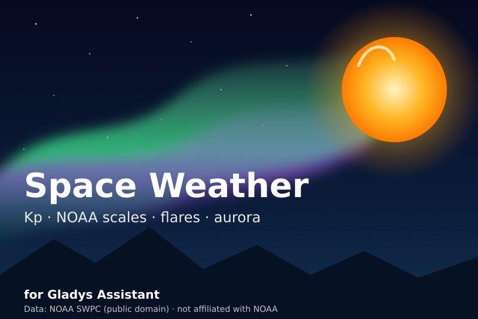
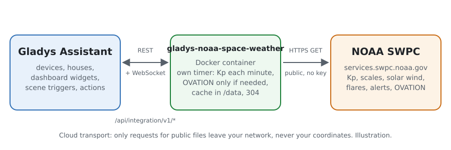
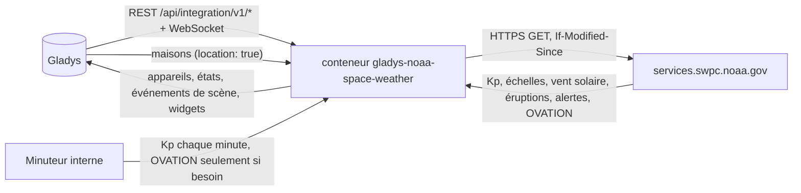
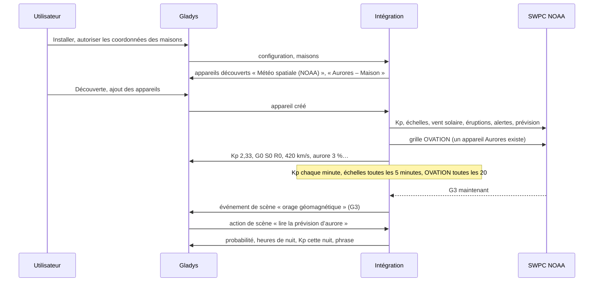
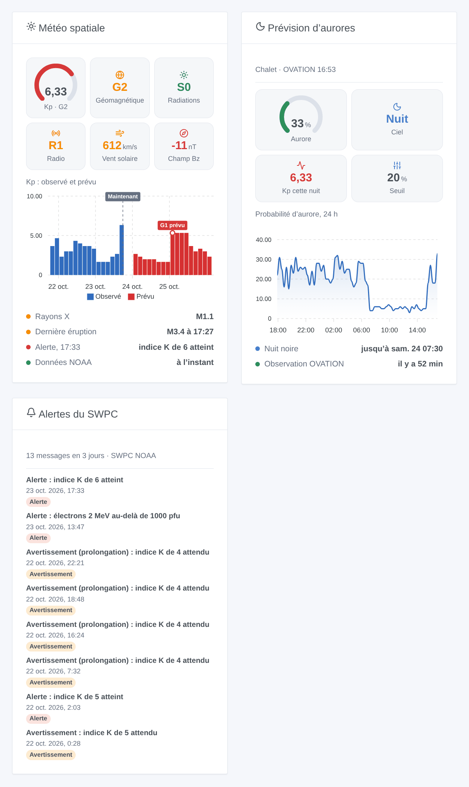

# Gladys NOAA Space Weather

[English](README.md) · **Français** · [Deutsch](README.de.md) · [Español](README.es.md)

[](LICENSE)
[](https://github.com/William-De71/gladys-noaa-space-weather/releases)
[](https://github.com/William-De71/gladys-noaa-space-weather/actions/workflows/release.yml)
[](https://gladysassistant.com)



Intégration externe [Gladys Assistant](https://gladysassistant.com) pour la météo spatiale du [Space Weather Prediction Center de la NOAA](https://www.swpc.noaa.gov/) (SWPC) : indice Kp, échelles NOAA des orages géomagnétiques, des tempêtes de radiations et des black-out radio, vent solaire, éruptions solaires, alertes du SWPC et prévision d’aurores OVATION dans chacune de vos maisons. Données publiques, sans compte ni clé : vos scènes savent quand un orage commence, quand une éruption X perturbe la radio, ou quand une aurore pourrait être visible chez vous cette nuit.

Documentation utilisateur : [English](docs/en.md) · [Français](docs/fr.md) · [Deutsch](docs/de.md) · [Español](docs/es.md).

Données : NOAA SWPC, domaine public (crédit : NOAA Space Weather Prediction Center). **Non affiliée à la NOAA.** Écrite et testée sur les vrais fichiers du SWPC du 23 octobre 2026, une journée calme : les cas d’orage sont testés sur des copies modifiées.

## Fonctionnalités

- **Appareil Météo spatiale** : Kp estimé (chaque minute), Kp officiel sur 3 heures, échelles NOAA G / S / R actuelles, vitesse du vent solaire, champ magnétique Bz et Bt, flux radio à 10,7 cm, classe du flux de rayons X.
- **Un appareil Aurores par maison localisée** : probabilité OVATION d’une aurore au zénith, nuit noire (soleil à 6° sous l’horizon), Kp maximal prévu pendant les prochaines heures de nuit noire.
- **9 déclencheurs de scène** (orage géomagnétique et sa fin, tempête de radiations, black-out radio, éruption M ou X, aurore possible et sa fin, nouveau message du SWPC, orage prévu), **3 actions de scène** (météo spatiale, aurore dans une maison, prévision à 3 jours, chacune avec une phrase prête à envoyer) et **3 widgets** (vue d’ensemble, aurores, alertes du SWPC).
- **Sobre avec un service gratuit** : chaque produit à son rythme, requêtes conditionnelles (un 304 pour un fichier inchangé), la grille d’aurores d’1 Mo seulement si un appareil Aurores ou un widget aurore en a besoin, une attente doublée après chaque échec, un petit cache dans `/data`.
- Les deux formats des fichiers du SWPC : les anciens tableaux (tableau de tableaux avec ligne d’en-tête) et les nouveaux tableaux d’objets.
- Quatre langues partout : anglais, français, allemand, espagnol.

## Fonctionnement





De l’installation à une scène :



### Transport

`transports: ["cloud"]` : tout vient de `services.swpc.noaa.gov`. **Rien de vous ne quitte votre réseau** hormis des requêtes de fichiers publics avec un User-Agent qui nomme l’intégration : ni compte, ni clé, jamais les coordonnées de vos maisons (la grille d’aurores est téléchargée entière et lue dans le conteneur). `/data` garde les dernières valeurs de chaque produit, les probabilités des dernières 24 heures par maison et ce que les déclencheurs savent déjà.

## Appareils et fonctionnalités

| Appareil              | Fonctionnalité                                                          | Catégorie / type      | Plage           |
| --------------------- | ----------------------------------------------------------------------- | --------------------- | --------------- |
| Météo spatiale (NOAA) | Kp estimé, indice Kp (3 h)                                              | `unknown` / `unknown` | 0–9             |
|                       | Orage géomagnétique (G), tempête de radiations (S), black-out radio (R) | `risk` / `integer`    | 0–5             |
|                       | Vent solaire (km/s)                                                     | `unknown` / `unknown` | 0–3 000         |
|                       | Champ magnétique Bz (nT), Bt (nT)                                       | `unknown` / `unknown` | −150–150, 0–200 |
|                       | Flux radio 10,7 cm (sfu)                                                | `unknown` / `unknown` | 0–1 000         |
|                       | Classe des rayons X                                                     | `text` / `text`       | « B5.4 »        |
| Aurores – maison      | Probabilité d’aurore (%), Kp prévu cette nuit                           | `unknown` / `unknown` | 0–100, 0–9      |
|                       | Nuit noire                                                              | `unknown` / `unknown` | 1 nuit, 0 jour  |

Gladys n’a pas d’unité pour les km/s, nT, sfu ni pour le Kp, et sa table des unités n’en donne aucune aux catégories `unknown`, `risk` et `text` : les fonctionnalités n’ont pas d’unité et l’indiquent dans leur nom (une vitesse en km/h afficherait 1 512 000 pour 420 km/s). Seuls les changements sont publiés, et tout est republié à la création d’un appareil.

## Déclencheurs, actions et widgets



| Type        | Clé                                 | Usage                                                                                                |
| ----------- | ----------------------------------- | ---------------------------------------------------------------------------------------------------- |
| Déclencheur | `geomagnetic_storm`                 | G atteint un nouveau niveau dans un épisode ; filtre par niveaux (G3, G4, G5 pour « G3 ou plus »)    |
| Déclencheur | `geomagnetic_storm_ended`           | retour à G0 depuis 3 heures                                                                          |
| Déclencheur | `radiation_storm`, `radio_blackout` | S ou R atteint un nouveau niveau                                                                     |
| Déclencheur | `solar_flare`                       | une éruption atteint M ou X (filtre X : les fortes seulement), avec classe, début, pic, niveau R     |
| Déclencheur | `aurora_possible`, `aurora_ended`   | sur un appareil Aurores : la probabilité atteint le seuil par nuit noire ; aube ou baisse            |
| Déclencheur | `swpc_alert`                        | chaque nouveau message du SWPC, filtré par type et sujet ; titre court traduit, texte en anglais     |
| Déclencheur | `storm_forecast`                    | un Kp de 5 ou plus prévu sous 3 jours, une fois par épisode                                          |
| Action      | `get_space_weather`                 | Kp, G/S/R, vent solaire, Bz, Bt, flux, rayons X, dernière éruption, phrase                           |
| Action      | `get_aurora`                        | une maison : probabilité, heures de nuit, Kp cette nuit, seuil, phrase                               |
| Action      | `get_forecast`                      | Kp maximal par jour UTC, G prévu, probabilités de R1–R2, R3+, S1+, phrase                            |
| Widget      | `overview`                          | jauge Kp, G/S/R, vent solaire, Bz, Kp observé et prévu, rayons X, dernière éruption, dernier message |
| Widget      | `aurora`                            | probabilité, ciel, Kp cette nuit, seuil, dernières 24 heures, heures de nuit                         |
| Widget      | `alerts`                            | les derniers messages du SWPC (types et période dans les réglages)                                   |

Chaque déclencheur fournit `{{triggerEvent.data.sentence}}`, une phrase dans la langue de la configuration. Les événements partent une fois par transition, jamais au démarrage ni suite à une action de scène. Exemples :

- Quand **NOAA : orage géomagnétique** avec G3, G4, G5 → envoyer `{{triggerEvent.data.sentence}}` en notification.
- Quand **NOAA : aurore possible** sur l’appareil Aurores du chalet → envoyer « Aurore possible cette nuit, {{triggerEvent.data.probability}} % : regardez vers le nord ».
- Quand **NOAA : éruption solaire** de classe X → prévenir le radioamateur : « Éruption X {{triggerEvent.data.class}} : radio HF et GPS perturbés possibles ».

## Prérequis

- Gladys Assistant **5.3.0** ou plus récent (widgets et scènes des intégrations, mots-clés du catalogue de Gladys 5.3) : les instances plus anciennes ne peuvent pas installer l’intégration.
- Internet : l’intégration ne parle qu’à `services.swpc.noaa.gov`.
- Pour les aurores : une maison localisée dans Gladys (l’intégration déclare `location: true` pour la lire).

### Latitude et aurores

Sous 55° de latitude magnétique environ (la plupart de la France, l’Espagne, l’Italie), une aurore est rare : il faut un orage fort (G3 ou plus) pour l’y amener, quelques fois par cycle solaire. En Scandinavie, en Islande, au Canada ou en Alaska, elle est fréquente. La probabilité OVATION est celle d’une aurore **au zénith** ; une aurore plus au nord peut tout de même se voir bas sur l’horizon nord, ce que cette valeur ne dit pas.

## Installation

- **Depuis le store** : Intégrations → NOAA Space Weather → Installer.
- **Depuis l’URL du dépôt** : Intégrations → intégration externe → `https://github.com/William-De71/gladys-noaa-space-weather`.
- **Mode développeur** : lancez `npm start` avec les variables données par Gladys (voir Développement).

## Configuration

| Champ ou bouton                  | Défaut      | Rôle                                                                                  |
| -------------------------------- | ----------- | ------------------------------------------------------------------------------------- |
| Langue des textes                | automatique | Noms des appareils, phrases et erreurs des scènes                                     |
| Seuil d’aurore                   | 10 %        | 5 à 50 % : à partir de là, une aurore est « possible » dans une maison par nuit noire |
| Tester la connexion / Diagnostic | —           | Lit les échelles et le Kp, liste les maisons localisées ; l’état dans les journaux    |

## Utilisation

1. Installez l’intégration et autorisez l’accès aux coordonnées des maisons.
2. Au besoin, appuyez sur **Tester la connexion**.
3. **Découverte**, puis ajoutez l’appareil Météo spatiale et les appareils Aurores des maisons voulues.
4. Ajoutez les widgets à un tableau de bord, et construisez des scènes avec les fonctionnalités, les déclencheurs et les actions.

## Développement

```bash
npm install
npm test                       # node --test, un faux SWPC sur 127.0.0.1 (vrais fichiers), jamais le réseau
npm run lint                   # ESLint
npm run format:check           # Prettier
npx github:GladysAssistant/integration-store . --skip-image-check
scripts/build-cover.sh         # cover.jpg depuis docs/assets/cover.svg
docs/illustrations/render.sh   # docs/assets/widgets.<lang>.png
```

En local, le SDK lit `GLADYS_HOST_API_URL`, `GLADYS_INTEGRATION_TOKEN` et `GLADYS_INTEGRATION_SELECTOR` (fournies par Gladys en mode développeur), et l’intégration lit `TZ`. `DEBUG=gladys-integration-sdk` affiche les journaux du SDK.

Les tests couvrent le client HTTP (User-Agent, 304, erreurs, JSON tronqué), les lecteurs (les deux formats, les premières minutes du Kp estimé), les messages du SWPC et leurs titres, la grille OVATION (longitudes 0–359 et la couture, les neuf cases, les pôles), le soleil et la nuit noire, chaque détecteur (transitions, pas de répétition, rien au démarrage), les sorties et les charges utiles, les appareils, les widgets (`validateWidgetContent`), le manifeste, les quatre langues, le script de release, et l’intégration entière face au faux Gladys du SDK et à un faux serveur SWPC. `test/structure.test.js` fige toutes les clés stockées chez l’utilisateur.

## Processus de release


Chaque fusion sur `main` lance la CI, puis calcule la version depuis les [Conventional Commits](https://www.conventionalcommits.org/) depuis le dernier tag : `feat` → mineure, `fix` / `perf` → correctif, `!` ou `BREAKING CHANGE` → majeure (une mineure sous 1.0.0) ; `docs`, `chore`, `ci`, `test`, `style`, `refactor`, `build` seuls ne publient rien. La section du changelog est générée, le tag poussé, l’image multi-architecture construite, puis `main` reçoit le commit de release, la GitHub Release est créée et un dernier job vérifie l’image publique, le validateur du store et le topic.

- Le titre de la pull request devient le commit squash, puis la ligne du changelog : écrivez-le en anglais, pour l’utilisateur (`pr-title.yml` le vérifie). N’éditez jamais `CHANGELOG.md` à la main.
- La 1.0.0 est une décision : Actions → Release → Run workflow avec `release-as: 1.0.0`. `dry-run` affiche la version et les notes sans rien publier.
- **Branche protégée** : la release pousse son commit sur `main` avec `GITHUB_TOKEN`. Le ruleset `protect-main` (pas de suppression, pas de force-push) le laisse passer ; une règle plus stricte (pull request obligatoire, status checks) demanderait GitHub Actions en contournement, ou une GitHub App.
- Après la première release, rendez public le package `ghcr.io` (Package settings → Change visibility), sinon Gladys ne peut pas le télécharger.

## Dépannage

Voir [docs/fr.md](docs/fr.md#dépannage). Signalez un problème avec les versions de Gladys et de l’intégration, le message de **Tester la connexion** et le résultat de **Diagnostic** (dans les journaux de l’intégration).

## Contribuer

Les issues et pull requests sont les bienvenues. Lancez `npm run format:check && npm run lint && npm test` avant d’ouvrir une pull request, et gardez inchangés les external ids et les clés stockées (voir [CLAUDE.md](CLAUDE.md)).

## Sécurité

Voir [SECURITY.md](SECURITY.md) : signalez les vulnérabilités en privé. L’intégration n’a aucun secret ; les coordonnées des maisons restent dans le conteneur et n’apparaissent jamais dans ses journaux.

## Captures à venir

Les images ci-dessus sont des illustrations, pas des captures d’écran. Les vraies captures iront dans `docs/assets/screenshots/` (PNG, 1280 × 800) : `configuration.png`, `discovery.png` (les appareils Météo spatiale et Aurores), `device.png` (l’appareil Météo spatiale et ses fonctionnalités), `scene-aurora.png` (une scène sur « aurore possible »).

## Licence

[Licence Apache 2.0](LICENSE) — voir aussi [NOTICE](NOTICE). Données : NOAA Space Weather Prediction Center, domaine public ; cette intégration n’est pas affiliée à la NOAA. Merci à la documentation et au SDK de Gladys, et au SWPC pour ses données ouvertes.
