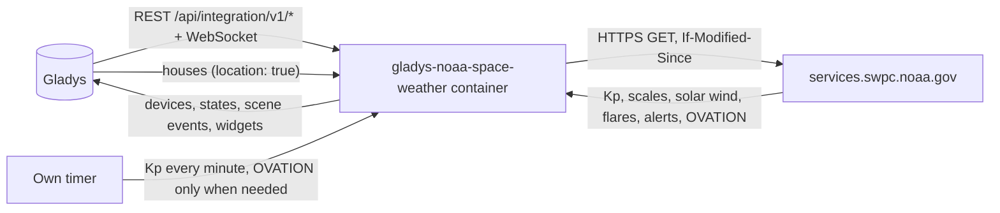
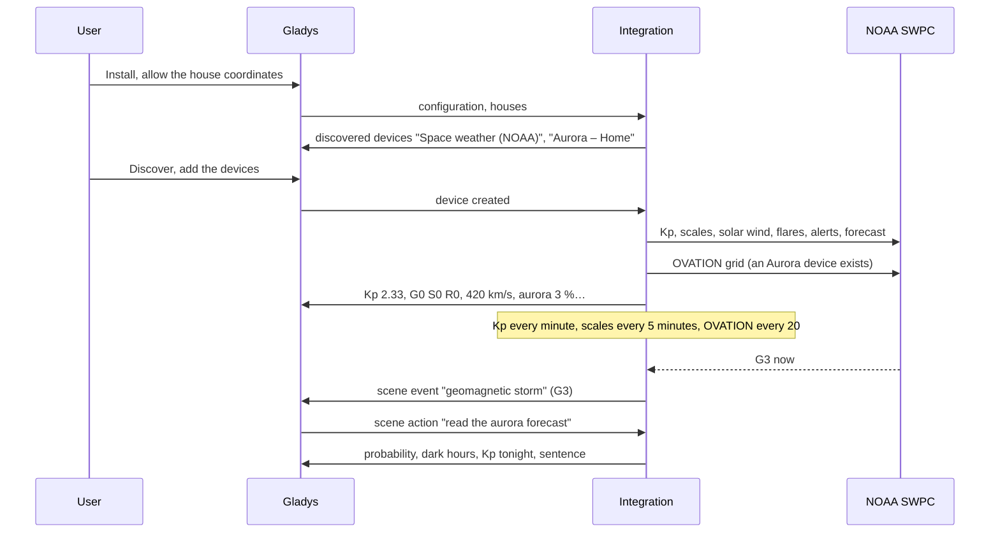
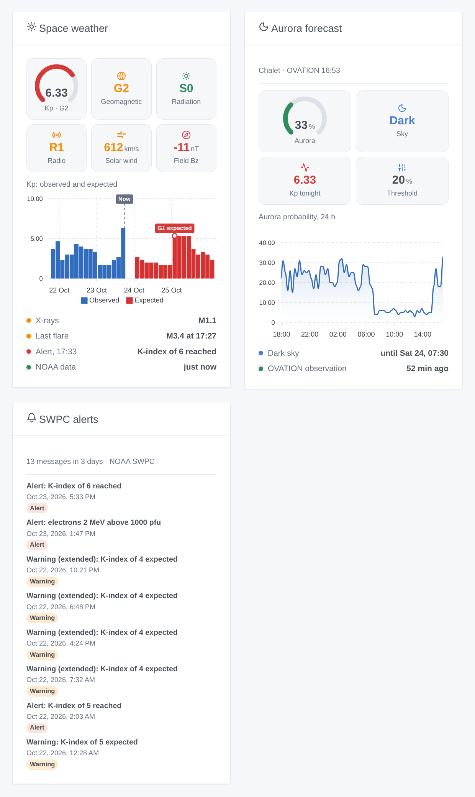

# Gladys NOAA Space Weather

**English** · [Français](README.fr.md) · [Deutsch](README.de.md) · [Español](README.es.md)

[](LICENSE)
[](https://github.com/William-De71/gladys-noaa-space-weather/releases)
[](https://github.com/William-De71/gladys-noaa-space-weather/actions/workflows/release.yml)
[](https://gladysassistant.com)


[Gladys Assistant](https://gladysassistant.com) external integration for the space weather of the [NOAA Space Weather Prediction Center](https://www.swpc.noaa.gov/) (SWPC): Kp index, NOAA scales of geomagnetic storms, radiation storms and radio blackouts, solar wind, solar flares, SWPC alerts and the OVATION aurora forecast at each of your houses. Public data, no account and no key: your scenes learn when a storm starts, when an X flare hits the radio, or when an aurora may be visible at home tonight.

User documentation: [English](docs/en.md) · [Français](docs/fr.md) · [Deutsch](docs/de.md) · [Español](docs/es.md).

Data: NOAA SWPC, public domain (credit: NOAA Space Weather Prediction Center). **Not affiliated with the NOAA.** Built and tested on the real files of the SWPC of 23 October 2026, a quiet day: the storm paths are tested on modified copies of them.

## Features

- **Space weather device**: estimated Kp (every minute), official 3-hour Kp, NOAA scales G / S / R now, solar wind speed, magnetic field Bz and Bt, 10.7 cm radio flux, class of the X-ray flux.
- **One Aurora device per located house**: OVATION probability of an aurora overhead, dark sky (the sun 6° below the horizon), the highest Kp expected during the next dark hours.
- **9 scene triggers** (geomagnetic storm and its end, radiation storm, radio blackout, M or X flare, aurora possible and its end, new SWPC message, storm in the forecast), **3 scene actions** (space weather, aurora at a house, 3-day forecast, each with a sentence ready to send) and **3 dashboard widgets** (overview, aurora, SWPC alerts).
- **Sober with a free service**: each product at its own pace, conditional requests (a 304 for an unchanged file), the 1 MB aurora grid only when an Aurora device or an aurora widget needs it, a doubled wait after each failure, a small cache in `/data`.
- Both formats of the SWPC files: the former tables (an array of arrays with a header row) and the new arrays of objects.
- Four languages everywhere: English, French, German, Spanish.

## How it works




From the installation to a scene:



### Transport

`transports: ["cloud"]`: everything comes from `services.swpc.noaa.gov`. **Nothing of yours leaves your network** apart from requests for public files with a User-Agent naming the integration: no account, no key, never the coordinates of your houses (the aurora grid is downloaded whole and read in the container). `/data` keeps the last values of each product, the probabilities of the last 24 hours per house and what the scene triggers already know.

## Devices and features

| Device               | Feature                                                              | Category / type       | Range           |
| -------------------- | -------------------------------------------------------------------- | --------------------- | --------------- |
| Space weather (NOAA) | Estimated Kp, Kp index (3 h)                                         | `unknown` / `unknown` | 0–9             |
|                      | Geomagnetic storm (G), solar radiation storm (S), radio blackout (R) | `risk` / `integer`    | 0–5             |
|                      | Solar wind (km/s)                                                    | `unknown` / `unknown` | 0–3,000         |
|                      | Magnetic field Bz (nT), Bt (nT)                                      | `unknown` / `unknown` | −150–150, 0–200 |
|                      | Radio flux 10.7 cm (sfu)                                             | `unknown` / `unknown` | 0–1,000         |
|                      | X-ray class                                                          | `text` / `text`       | "B5.4"          |
| Aurora – house       | Aurora probability (%), Kp expected tonight                          | `unknown` / `unknown` | 0–100, 0–9      |
|                      | Dark sky                                                             | `unknown` / `unknown` | 1 dark, 0 light |

Gladys has no unit for km/s, nT, sfu nor the Kp, and its table of units gives none to the `unknown`, `risk` and `text` categories: the features carry no unit and say it in their name (a speed in km/h would show 1,512,000 for 420 km/s). Only the changes are published, and everything again when a device is created.

## Scene triggers, actions and widgets



| Kind    | Key                                 | Use                                                                                         |
| ------- | ----------------------------------- | ------------------------------------------------------------------------------------------- |
| Trigger | `geomagnetic_storm`                 | G reaches a new level in an episode; filter by levels (G3, G4, G5 for "G3 or more")         |
| Trigger | `geomagnetic_storm_ended`           | back to G0 for 3 hours                                                                      |
| Trigger | `radiation_storm`, `radio_blackout` | S or R reaches a new level                                                                  |
| Trigger | `solar_flare`                       | a flare reaches M or X (filter X: strong only), with class, begin, peak, R level            |
| Trigger | `aurora_possible`, `aurora_ended`   | at an Aurora device: the probability reaches the threshold in a dark sky; dawn or decrease  |
| Trigger | `swpc_alert`                        | each new SWPC message, filtered by kind and topic; short title translated, text in English  |
| Trigger | `storm_forecast`                    | a Kp of 5 or more expected within 3 days, once per episode                                  |
| Action  | `get_space_weather`                 | Kp, G/S/R, solar wind, Bz, Bt, flux, X-rays, last flare, sentence                           |
| Action  | `get_aurora`                        | a house: probability, dark hours, Kp tonight, threshold, sentence                           |
| Action  | `get_forecast`                      | highest Kp per UTC day, G expected, chances of R1–R2, R3+, S1+, sentence                    |
| Widget  | `overview`                          | Kp gauge, G/S/R, solar wind, Bz, Kp observed and expected, X-rays, last flare, last message |
| Widget  | `aurora`                            | probability, sky, Kp tonight, threshold, last 24 hours, dark hours                          |
| Widget  | `alerts`                            | the last SWPC messages (kinds and period in the settings)                                   |

Every trigger gives `{{triggerEvent.data.sentence}}`, a sentence in the language of the configuration. Events fire once per transition, never at startup nor from a scene action. Examples:

- When **NOAA: geomagnetic storm** with G3, G4, G5 → send `{{triggerEvent.data.sentence}}` as a notification.
- When **NOAA: aurora possible** at the Aurora device of the chalet → send "Aurora possible tonight, {{triggerEvent.data.probability}} %: look north".
- When **NOAA: solar flare** with class X → warn the radio amateur: "X flare {{triggerEvent.data.class}}: HF radio and GPS may be disturbed".

## Requirements

- Gladys Assistant **5.1.0** or later (widgets and scenes of integrations): older instances cannot install the integration.
- The internet: the integration talks to `services.swpc.noaa.gov` only.
- For the aurora: a house with a location in Gladys (the integration declares `location: true` to read it).

### Latitude and aurora

Below about 55° of magnetic latitude (most of France, Spain, Italy) an aurora is rare: it takes a strong storm (G3 or more) to bring it there, a few times per solar cycle. In Scandinavia, Iceland, Canada or Alaska it is common. The OVATION probability is for an aurora **overhead**; an aurora further north may still be seen low on the northern horizon, which this value does not tell.

## Installation

- **From the store**: Integrations → NOAA Space Weather → Install.
- **From the repository URL**: Integrations → external integration → `https://github.com/William-De71/gladys-noaa-space-weather`.
- **Developer mode**: run `npm start` with the variables given by Gladys (see Development).

## Configuration

| Field or button                  | Default   | Meaning                                                                      |
| -------------------------------- | --------- | ---------------------------------------------------------------------------- |
| Language of the texts            | automatic | Device names, scene sentences and errors                                     |
| Aurora threshold                 | 10 %      | 5 to 50 %: from it, an aurora is "possible" at a house in a dark sky         |
| Test the connection / Diagnostic | —         | Reads the scales and the Kp, lists the located houses; the state in the logs |

## Usage

1. Install the integration and allow the coordinates of the houses.
2. Optionally press **Test the connection**.
3. **Discover**, then add the Space weather device and the Aurora devices of the houses you want.
4. Add the widgets to a dashboard, and build scenes with the features, the triggers and the actions.

## Development

```bash
npm install
npm test                       # node --test, a fake SWPC on 127.0.0.1 (real files), never the network
npm run lint                   # ESLint
npm run format:check           # Prettier
npx github:GladysAssistant/integration-store . --skip-image-check
scripts/build-cover.sh         # cover.jpg from docs/assets/cover.svg
docs/illustrations/render.sh   # docs/assets/widgets.<lang>.png
```

Locally, the SDK reads `GLADYS_HOST_API_URL`, `GLADYS_INTEGRATION_TOKEN` and `GLADYS_INTEGRATION_SELECTOR` (given by Gladys in developer mode), and the integration reads `TZ`. `DEBUG=gladys-integration-sdk` shows the SDK logs.

The tests cover the HTTP client (User-Agent, 304, errors, a truncated JSON), the readers (both formats, the settling minutes of the estimated Kp), the SWPC messages and their titles, the OVATION grid (longitudes 0–359 and the seam, the nine cells, the poles), the sun and the dark sky, every detector (transitions, no repeat, no event at startup), the outputs and payloads, the devices, the widgets (`validateWidgetContent`), the manifest, the four languages, the release script, and the whole integration against the fake Gladys of the SDK and a fake SWPC HTTP server. `test/structure.test.js` freezes every key users store.

## Release process


Every merge on `main` runs the CI, then computes the version from the [Conventional Commits](https://www.conventionalcommits.org/) since the last tag: `feat` → minor, `fix` / `perf` → patch, `!` or `BREAKING CHANGE` → major (a minor below 1.0.0); `docs`, `chore`, `ci`, `test`, `style`, `refactor`, `build` alone publish nothing. The changelog section is generated, the tag pushed, the multi-architecture image built, then `main` receives the release commit, the GitHub Release is created and a last job checks the public image, the store validator and the topic.

- The pull request title becomes the squash commit, then the changelog line: write it in English, for the user (`pr-title.yml` checks it). Never edit `CHANGELOG.md` by hand.
- 1.0.0 is a decision: Actions → Release → Run workflow with `release-as: 1.0.0`. `dry-run` shows the version and the notes without publishing.
- **Protected branch**: the release pushes its commit to `main` with `GITHUB_TOKEN`. The `protect-main` ruleset (no deletion, no force-push) lets it through; a stricter rule (pull request required, status checks) would need GitHub Actions in its bypass list, or a GitHub App.
- After the first release, make the `ghcr.io` package public (Package settings → Change visibility), or Gladys cannot pull it.

## Troubleshooting

See [docs/en.md](docs/en.md#troubleshooting). Report issues with the versions of Gladys and of the integration, the message of **Test the connection** and the result of **Diagnostic** (in the logs of the integration).

## Contributing

Issues and pull requests are welcome. Run `npm run format:check && npm run lint && npm test` before opening a pull request, and keep every external id and stored key unchanged (see [CLAUDE.md](CLAUDE.md)).

## Security

See [SECURITY.md](SECURITY.md): report vulnerabilities privately. The integration has no secret; the coordinates of the houses stay in the container and never appear in its logs.

## Screenshots to come

The images above are illustrations, not screenshots. Real screenshots will go in `docs/assets/screenshots/` (PNG, 1280 × 800): `configuration.png`, `discovery.png` (the Space weather and Aurora devices), `device.png` (the Space weather device with its features), `scene-aurora.png` (a scene on "aurora possible").

## License

[Apache License 2.0](LICENSE) — see also [NOTICE](NOTICE). Data: NOAA Space Weather Prediction Center, public domain; this integration is not affiliated with the NOAA. Thanks to the Gladys documentation and SDK, and to the SWPC for its open data.
